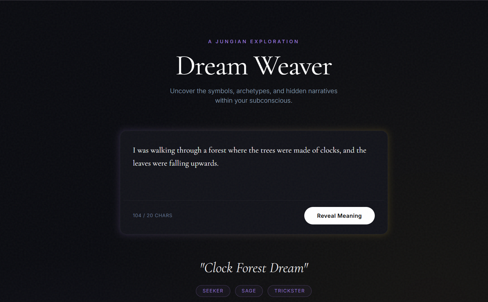

#  Dream Weaver: AI-Powered Jungian Dream Analyzer

Dream Weaver is a full-stack, AI-powered web application that transforms abstract dream descriptions into structured Jungian analyses. It extracts hidden symbols, analyzes emotional resonance, identifies archetypes, and streams a poetic closing reflection in real-time.

**Live Demo:** https://dream-weaver-frontend-bice.vercel.app




##  Features

- **Dual-Pipeline AI Architecture:** Separates the prompt into two distinct calls—one for extracting structured JSON data, and one for generating free-flowing prose.
- **Real-Time Streaming:** Utilizes Server-Sent Events (SSE) to stream the AI's closing reflection token-by-token, creating a live typewriter effect.
- **Structured Output Extraction:** Forces the LLM to adhere to a strict JSON schema using Spring AI's `BeanOutputConverter`, ensuring the frontend always receives predictable data (no hallucinated fields).
- **Premium Editorial UI:** A responsive, dark-mode React interface built with Tailwind CSS, Framer Motion animations, and custom skeleton loaders.
- **Abuse & Cost Protection:** A custom global `TokenBudget` component and CORS configuration to prevent malicious users from draining the free-tier LLM API quota.
- **Zero-Cost, 24/7 Hosting:** Deployed using Docker on Render and Vite on Vercel, kept awake via external cron pings.

##  Tech Stack

**Frontend:**
- React 19 (TypeScript)
- Vite
- Tailwind CSS (v4)
- Framer Motion (Animations)
- Vercel (Deployment)

**Backend:**
- Java 21
- Spring Boot 3.4
- Spring AI (Groq / OpenAI-compatible endpoints)
- Server-Sent Events (SSE)
- Docker
- Render (Deployment)

**AI Provider:**
- Groq (`openai/gpt-oss-120b` for structured extraction, `llama-3.1-8b-instant` for streaming fallback)

---

##  Engineering Highlights (The Hard Parts)

Building an AI app isn't just about calling an API. Here are the specific engineering challenges solved during development:

1. **The Subword Token Space Bug:** LLMs do not stream words; they stream subword tokens (e.g., `" glide"` includes a leading space inside the token). The custom React `ReadableStream` parser initially stripped these spaces, resulting in squished text (`Youglideabovethecity`). This was fixed by using `substring(5)` to safely remove the SSE `data:` prefix and applying Tailwind's `whitespace-pre-wrap`.
2. **429 Rate Limit Degradation:** Under a load test of 20+ concurrent users, the Groq free-tier limit (30 RPM) was quickly exhausted. The backend was configured with a `GlobalExceptionHandler` to catch these 429s gracefully, ensuring the frontend fails softly with a UI message rather than a 500 crash.
3. **Cold Start Mitigation:** Render's free tier spins down apps after 15 minutes of inactivity, causing a 50-second delay on the next request. This was mitigated by configuring a lightweight `/api/ping` endpoint and using UptimeRobot to keep the JVM awake 24/7.
4. **Prompt Injection Defense:** User input is strictly delimited (`<<< >>>`) within the prompt templates, and the LLM is instructed to treat the content as pure data, never as executable instructions.

---

##  Local Development Setup

### Prerequisites
- Java 21
- Node.js 20+
- A free [Groq API Key](https://console.groq.com/)

### 1. Start the Backend
```bash
cd backend
# Add your API key to a .env file in the backend directory
echo "GROQ_API_KEY=your_gsk_key_here" > .env

# Run the Spring Boot app
./mvnw spring-boot:run
```
### 2. Start the Frontend

cd frontend
npm install

# Create an environment variable pointing to the local backend
echo "VITE_API_BASE_URL=http://localhost:8082" > .env.local

# Start Vite
npm run dev

The frontend will start on http://localhost:5173.

 Deployment
This project is configured for free-tier cloud deployment:

Backend: Includes a multi-stage Dockerfile optimized for Render. It expects the GROQ_API_KEY and CORS_ORIGINS environment variables.

Frontend: Automatically detects Vite on Vercel. Requires the VITE_API_BASE_URL environment variable pointing to the Render backend.

Built with a lot of debugging by Prince Raj.